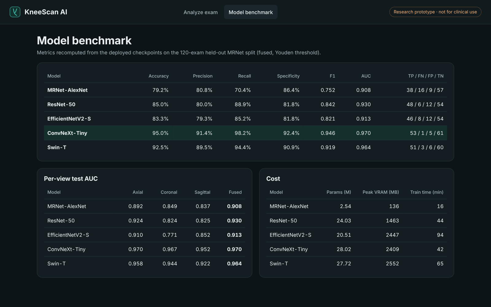

# KneeScan AI: ACL Tear Detection on Knee MRI

Deep learning pipeline and web application that detects anterior cruciate ligament (ACL) tears from knee MRI exams. Five CNN and Transformer backbones are benchmarked inside one shared **gated-attention multiple instance learning (MIL)** pipeline on the [Stanford MRNet](https://stanfordmlgroup.github.io/competitions/mrnet/) dataset, and the best model is served through a local web app with per-slice attention and Grad-CAM explanations.

> **Research prototype.** Not a medical device and not validated for clinical use.



## Results

Held-out MRNet validation split (120 exams: 54 tears, 66 intact). Each model fuses three per-plane networks; thresholds are tuned with Youden's J on an internal validation split, never on the test set.

| Model | Params | Accuracy | Precision | Recall | Specificity | F1 | AUC |
|---|---|---|---|---|---|---|---|
| **ConvNeXt-Tiny** | 28.0 M | **95.0%** | **91.4%** | **98.1%** | **92.4%** | **0.946** | **0.970** |
| Swin-T | 27.7 M | 92.5% | 89.5% | 94.4% | 90.9% | 0.919 | 0.964 |
| ResNet-50 | 24.0 M | 85.0% | 80.0% | 88.9% | 81.8% | 0.842 | 0.930 |
| EfficientNetV2-S | 20.5 M | 83.3% | 79.3% | 85.2% | 81.8% | 0.821 | 0.913 |
| MRNet-AlexNet (baseline) | 2.5 M | 79.2% | 80.9% | 70.4% | 86.4% | 0.753 | 0.908 |

<details>
<summary>Per-plane AUC and training cost</summary>

| Model | Axial | Coronal | Sagittal | Fused | Training time | Peak VRAM |
|---|---|---|---|---|---|---|
| ConvNeXt-Tiny | 0.970 | 0.967 | 0.952 | 0.970 | 42 min | 2,409 MB |
| Swin-T | 0.958 | 0.944 | 0.922 | 0.964 | 65 min | 2,552 MB |
| ResNet-50 | 0.924 | 0.824 | 0.825 | 0.930 | 44 min | 1,463 MB |
| EfficientNetV2-S | 0.911 | 0.771 | 0.852 | 0.913 | 94 min | 2,447 MB |
| MRNet-AlexNet | 0.893 | 0.849 | 0.837 | 0.908 | 16 min | 136 MB |

Training on a single NVIDIA L4 (Google Colab), mixed precision, batch of 2 exams × 12 slices. Times are the sum over the three planes.
</details>

Key findings:
- ConvNeXt-Tiny leads on every metric and misses only 1 of 54 tears.
- Learned fusion of the three planes matches or beats the best single plane for every backbone.
- The axial plane is the strongest single view for all five models.
- The 2.5 M-parameter AlexNet baseline still exceeds AUC 0.90, making it a viable low-resource option.

All results come from a single training seed; differences of one or two exams are within run-to-run variation.

## Method

```
3 MRI planes ─► 12 slices / plane ─► backbone (per slice) ─► gated attention ─► plane probability
(axial, coronal,  central 60%,          ImageNet-pretrained     pooling over        (× 3 planes)
 sagittal)        224×224, z-score                              slices                    │
                                                                                          ▼
                                     tear / intact ◄── Youden threshold ◄── logistic-regression fusion
```

- **Slice sampling:** 12 evenly spaced slices from the central 60% of each volume, centre-cropped to 224 × 224 and normalised per plane.
- **MIL pooling:** gated attention ([Ilse et al., 2018](https://arxiv.org/abs/1802.04712)) learns a weight per slice; the weights double as a slice-level explanation.
- **Backbones:** AlexNet, ResNet-50, EfficientNetV2-S, ConvNeXt-Tiny, Swin-T (torchvision / timm, ImageNet weights).
- **Loss:** class-weighted binary cross-entropy + focal term (γ = 2) with label smoothing (0.05).
- **Optimisation:** AdamW (backbone 1e-5, head 1e-4), cosine annealing with warm restarts, MixUp (α = 0.2), early stopping on validation AUC, test-time augmentation (3 passes).
- **Fusion:** logistic regression over the three plane probabilities, fitted on the internal validation split; fuzzy-distance fusion ([Wang et al., 2024](https://doi.org/10.3390/tomography10080094)) as a fallback when planes are missing.
- **Explainability:** Grad-CAM on the most-attended slice of each plane.

Data split: the 1,130 public training exams are split 80/20 (stratified) into train (904) and internal validation (226). The official 120-exam validation set is used only as the held-out test set.

## Repository structure

```
├── app.py                      FastAPI server: serves the UI and the inference API
├── kneescan/
│   ├── model_def.py            MIL model and backbone definitions (match the training notebook)
│   └── inference.py            preprocessing, TTA, fusion, thresholding, attention and Grad-CAM
├── static/index.html           web front end
├── notebook/
│   └── ACL_MRNet_Robust_Final.ipynb   training and evaluation notebook (Colab)
├── export_for_app.py           packages trained checkpoints into deploy/ for the app
├── tools/make_dummy_deploy.py  random-weight deploy folder for installation smoke tests
├── docs/                       images for this README
└── requirements.txt
```

## Quick start

Requirements: Python 3.10–3.12, about 8 GB RAM. A GPU is optional; CPU inference takes roughly 2 s per exam for AlexNet and 8–12 s for the larger models.

```bash
git clone [https://github.com/<your-username>/<your-repo>.git](https://github.com/iamarshiya/acl-tear-detection-mrnet.git)
cd acl-tear-detection-mrnet
python -m venv .venv
# Windows: .venv\Scripts\activate    macOS/Linux: source .venv/bin/activate
python -m pip install -r requirements.txt
```

Download the trained weights (`deploy.zip`, see **Pretrained weights** below) and extract them so that `deploy/config.json` exists, then:

```bash
python -m uvicorn app:app --port 8000
```

Open <http://localhost:8000>.

To check the installation without trained weights:

```bash
python tools/make_dummy_deploy.py deploy_dummy
# Windows (PowerShell): $env:KNEESCAN_DEPLOY="deploy_dummy"   macOS/Linux: export KNEESCAN_DEPLOY=deploy_dummy
python -m uvicorn app:app --port 8000
```

The dummy models have random weights, so their predictions are meaningless.

## Pretrained weights

The `deploy/` folder (about 1.1 GB) holds the 15 checkpoints (5 backbones × 3 planes) and a `config.json` with normalisation statistics, fusion weights, thresholds and test metrics. It is not stored in this repository because of its size.

- Download: [Deploy.zip](https://drive.google.com/file/d/1slgzkr7fCq4WCu2xLw9mkHWliSYni56j/view?usp=sharing)
- If a checkpoint fails to load, install the timm version listed under `versions` in `deploy/config.json`.

MRNet scans are not redistributed here. To use the app's built-in test exams, place MRNet validation volumes in `deploy/samples/<exam_id>/{axial,coronal,sagittal}.npy` and list them under `samples` in `config.json`, or upload `.npy` files through the UI.

## Training from scratch

1. Request access to [MRNet v1.0](https://stanfordmlgroup.github.io/competitions/mrnet/) and accept its research use agreement.
2. Open `notebook/ACL_MRNet_Robust_Final.ipynb` in Google Colab with a GPU runtime (L4 or A100 recommended).
3. Add your data credentials as Colab secrets and point `out_dir` / `ckpt_dir` / `results_file` in the config cell to Google Drive, so checkpoints survive disconnects.
4. Run the cells in order. Training resumes automatically: completed models are skipped on re-run.
5. In the same session, export the checkpoints for the app:
   ```
   %run -i export_for_app.py
   ```
   This writes `deploy.zip`, recomputing fusion weights and thresholds from the saved checkpoints.

## Using the app

- **Analyze exam:** choose a built-in test exam or upload axial, coronal and sagittal `.npy` volumes (slices × 256 × 256), pick a backbone and run. The result shows the fused tear probability against the decision threshold, per-plane probabilities, slice attention weights and a Grad-CAM overlay. Missing planes fall back to the available ones.
- **Model benchmark:** test-set metrics, confusion counts, per-plane AUC and training cost for every exported model.

### API

| Method | Endpoint | Body | Returns |
|---|---|---|---|
| `GET` | `/api/info` | — | available models, test metrics, sample exams |
| `POST` | `/api/predict` | form: `model`; files: `axial`, `coronal`, `sagittal` (`.npy`, any subset) | prediction JSON |
| `POST` | `/api/predict_sample` | form: `model`, `sample_id` | prediction JSON with ground truth |

Interactive API docs: <http://localhost:8000/docs>.

## Limitations

- Single training seed and a 120-exam test set; no confidence intervals yet.
- Single institution (Stanford) data; external validation on other scanners and populations is needed.
- The test split has a higher tear prevalence (45%) than the training data (18%), which affects threshold-based metrics.
- Grad-CAM maps have not been reviewed by radiologists.

## Acknowledgements

- X. Wang et al., *Deep Learning-Assisted Automatic Diagnosis of Anterior Cruciate Ligament Tear in Knee Magnetic Resonance Images*, Tomography, 2024.
- N. Bien et al., *Deep-learning-assisted diagnosis for knee magnetic resonance imaging: development and retrospective validation of MRNet*, PLOS Medicine, 2018.
- M. Ilse, J. Tomczak, M. Welling, *Attention-based Deep Multiple Instance Learning*, ICML, 2018.
